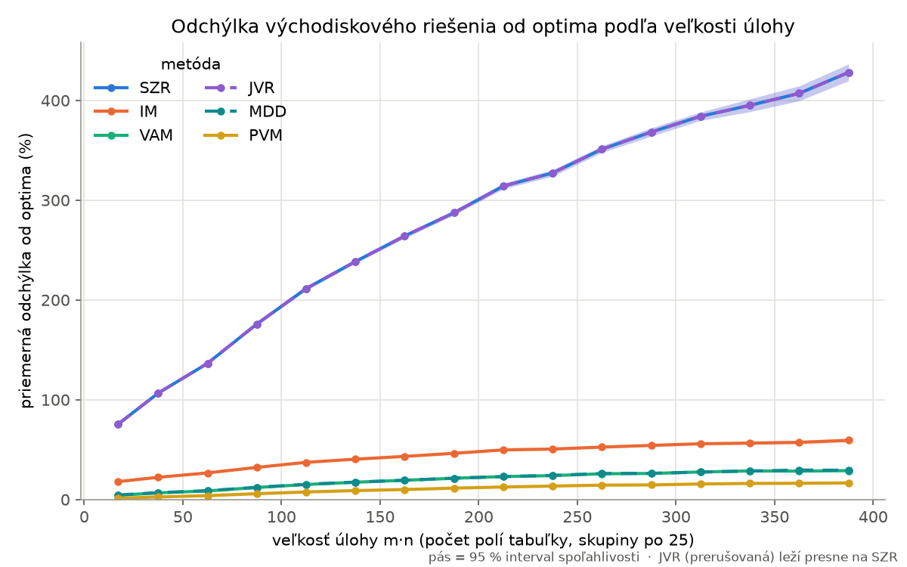
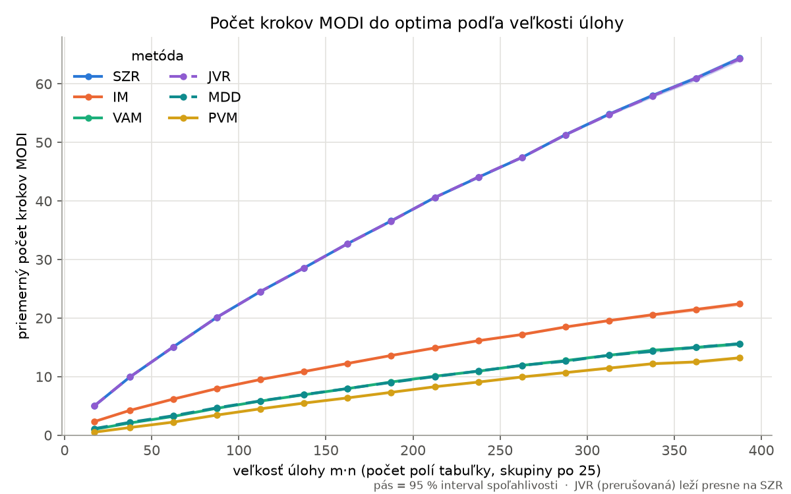
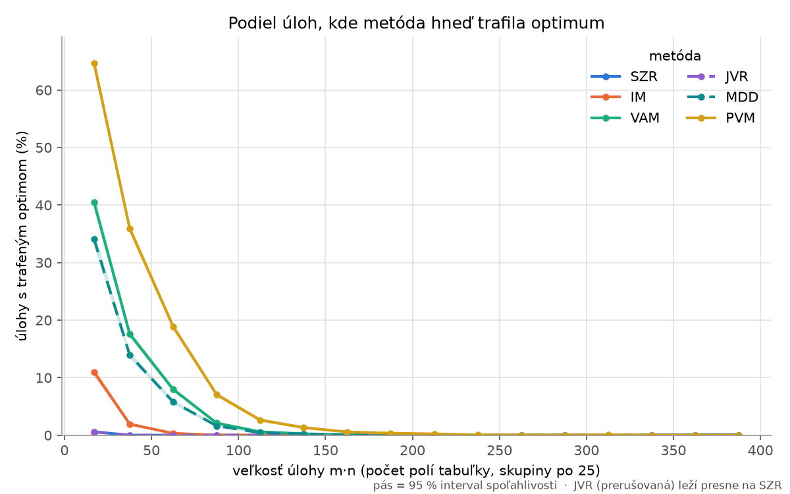
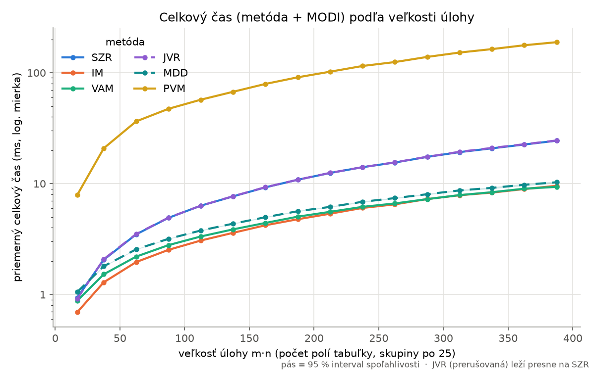
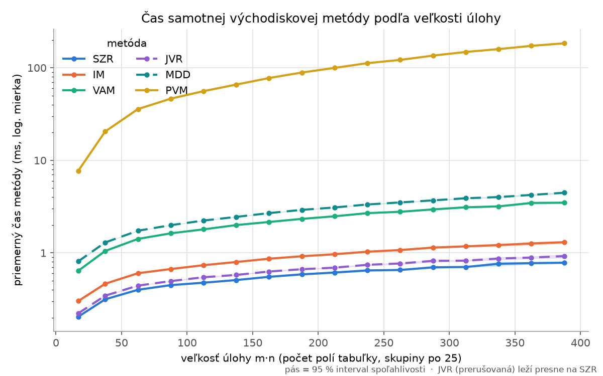
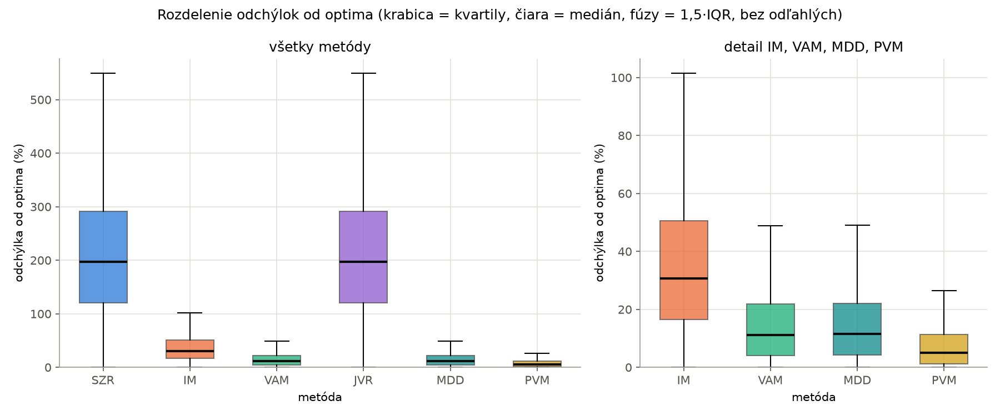
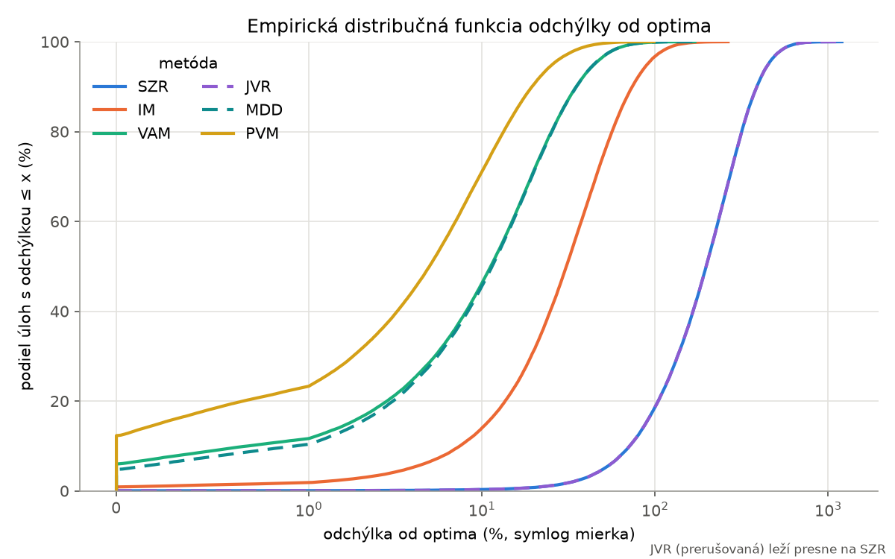
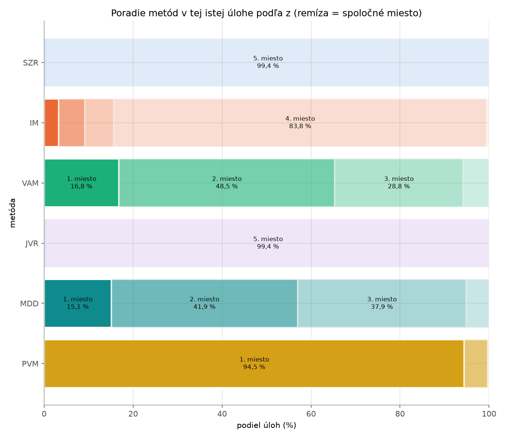
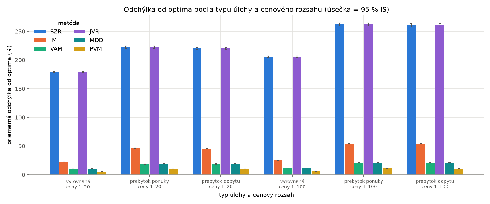

# Súhrn výsledkov – beh `hlavny100k`

Vygenerované skriptom `analyza.py` z CSV; všetky čísla sú dopočítateľné spustením `.venv\Scripts\python.exe analyza.py hlavny100k`.

## Parametre behu

| parameter | hodnota |
|---|--:|
| súbor | `vysledky/beh_hlavny100k.csv` |
| seed | 20261025 |
| počet úloh N | 100 000 |
| m, n | [3, 20], [3, 20] (nezávisle) |
| ceny | 1-20: 0.5, 1-100: 0.5 |
| typ úlohy | vyrovnana: 0.5, prebytok_ponuky: 0.25, prebytok_dopytu: 0.25 |
| kapacity – základ, prebytok | [10, 100], [0.05, 0.3] |
| procesy / blok | 16 / 100 |
| trvanie behu | 588,9 s |
| chyby v behu | 0 |
| prostredie | Python 3.13.15, numpy 2.5.4, Windows-11-10.0.26300-SP0, 16 log. CPU |
| dátum behu | 2026-10-27 08:46:57 |

Odchýlka = (z − z*) / z* · 100 %. Časy sú merané `perf_counter_ns` vnútri procesu pri 16 paralelných procesoch – absolútne hodnoty sú orientačné, porovnanie metód je spravodlivé (rovnaké podmienky). Intervaly v hranatých zátvorkách = 95 % interval spoľahlivosti (priemer: normálna aproximácia; podiel: Wilson; medián a kvartily: neparametrický z poradových štatistík).

Metódy v behu: SZR, IM, VAM, JVR, MDD, PVM.

Kontrola dát: z* rovnaké pre všetky metódy (6) v úlohe: **áno**; z ≥ z* všade: **áno**; stĺpec `optimum` = (z = z*): **áno**.

## 1. Celkové porovnanie – správnosť

| metóda | trafila optimum (%) | priemer odchýlky (%) | medián (%) | 1. kvartil (%) | 3. kvartil (%) | max (%) |
|---|--:|--:|--:|--:|--:|--:|
| **SZR** | 0,03 [0,02; 0,05] | 216,86 [216,08; 217,65] | 197,31 [196,31; 198,26] | 119,92 [119,01; 120,80] | 291,69 [290,51; 293,03] | 1 199,9 |
| **IM** | 0,88 [0,83; 0,94] | 36,77 [36,60; 36,94] | 30,75 [30,57; 30,95] | 16,52 [16,37; 16,67] | 50,51 [50,21; 50,79] | 264,0 |
| **VAM** | 6,00 [5,85; 6,15] | 15,26 [15,17; 15,35] | 11,24 [11,14; 11,35] | 4,04 [3,98; 4,11] | 21,96 [21,80; 22,12] | 169,7 |
| **JVR** | 0,03 [0,02; 0,05] | 216,86 [216,08; 217,65] | 197,31 [196,31; 198,26] | 119,92 [119,01; 120,80] | 291,69 [290,51; 293,03] | 1 199,9 |
| **MDD** | 4,78 [4,65; 4,92] | 15,40 [15,31; 15,49] | 11,46 [11,36; 11,56] | 4,25 [4,18; 4,31] | 22,14 [21,98; 22,29] | 168,1 |
| **PVM** | 12,31 [12,11; 12,52] | 7,83 [7,77; 7,88] | 4,98 [4,92; 5,04] | 1,19 [1,16; 1,22] | 11,32 [11,24; 11,42] | 98,6 |

## 2. Celkové porovnanie – efektívnosť

| metóda | kroky MODI – priemer | kroky MODI – medián | čas metódy (µs) priemer / medián | čas MODI (µs) priemer / medián | celkový čas (µs) priemer / medián |
|---|--:|--:|--:|--:|--:|
| **SZR** | 26,61 [26,52; 26,71] | 24 | 484,4 [481,5; 487,3] / 418,4 | 7 192,4 [7 155,5; 7 229,3] / 5 464,6 | 7 676,8 [7 638,8; 7 714,8] / 5 925,4 |
| **IM** | 10,09 [10,05; 10,12] | 9 | 753,4 [749,3; 757,5] / 637,8 | 2 772,0 [2 756,9; 2 787,0] / 2 126,6 | 3 525,3 [3 508,4; 3 542,3] / 2 831,5 |
| **VAM** | 6,37 [6,34; 6,39] | 5 | 1 866,1 [1 858,5; 1 873,8] / 1 644,7 | 1 870,7 [1 859,1; 1 882,2] / 1 335,7 | 3 736,8 [3 720,1; 3 753,5] / 3 075,9 |
| **JVR** | 26,61 [26,51; 26,70] | 24 | 548,3 [545,3; 551,2] / 471,9 | 7 155,8 [7 118,9; 7 192,7] / 5 436,6 | 7 704,1 [7 666,0; 7 742,2] / 5 970,1 |
| **MDD** | 6,41 [6,38; 6,44] | 5 | 2 316,1 [2 307,0; 2 325,2] / 2 029,0 | 1 893,5 [1 881,7; 1 905,4] / 1 354,7 | 4 209,7 [4 191,5; 4 227,9] / 3 496,9 |
| **PVM** | 5,02 [5,00; 5,05] | 4 | 64 565,7 [64 277,4; 64 853,9] / 53 443,2 | 1 573,4 [1 563,3; 1 583,6] / 1 099,8 | 66 139,1 [65 843,3; 66 434,9] / 54 733,9 |

| metóda | najkratší celkový čas v úlohe (%) | najmenej krokov MODI v úlohe, vrátane remíz (%) | najrýchlejšia samotná metóda (%) |
|---|--:|--:|--:|
| SZR | 0,67 | 0,08 | 91,08 |
| IM | 60,78 | 6,56 | 0,08 |
| VAM | 32,78 | 36,84 | 0,00 |
| JVR | 0,79 | 0,08 | 8,84 |
| MDD | 4,98 | 34,14 | 0,00 |
| PVM | 0,00 | 80,64 | 0,00 |

## 3. Párové porovnanie na tej istej úlohe

| metóda | 1. miesto (%) | 2. miesto (%) | 3. miesto (%) | 4. miesto (%) | 5. miesto (%) | 6. miesto (%) | sama 1. (bez remízy) (%) |
|---|--:|--:|--:|--:|--:|--:|--:|
| **SZR** | 0,05 [0,04; 0,06] | 0,04 [0,03; 0,06] | 0,04 [0,03; 0,05] | 0,52 [0,48; 0,57] | 99,35 [99,30; 99,40] | 0,00 [0,00; 0,00] | 0,00 |
| **IM** | 3,25 [3,14; 3,36] | 5,89 [5,75; 6,04] | 6,52 [6,37; 6,68] | 83,76 [83,53; 83,99] | 0,01 [0,01; 0,02] | 0,56 [0,51; 0,61] | 2,00 |
| **VAM** | 16,79 [16,56; 17,03] | 48,54 [48,23; 48,85] | 28,80 [28,53; 29,09] | 5,82 [5,68; 5,97] | 0,02 [0,02; 0,04] | 0,01 [0,01; 0,02] | 0,40 |
| **JVR** | 0,05 [0,04; 0,06] | 0,04 [0,03; 0,06] | 0,04 [0,03; 0,05] | 0,52 [0,48; 0,57] | 99,35 [99,30; 99,40] | 0,00 [0,00; 0,00] | 0,00 |
| **MDD** | 15,10 [14,88; 15,33] | 41,87 [41,57; 42,18] | 37,90 [37,60; 38,20] | 5,07 [4,94; 5,21] | 0,04 [0,03; 0,06] | 0,01 [0,01; 0,02] | 3,10 |
| **PVM** | 94,46 [94,31; 94,60] | 5,30 [5,16; 5,44] | 0,23 [0,20; 0,26] | 0,01 [0,01; 0,02] | 0,00 [0,00; 0,00] | 0,00 [0,00; 0,00] | 74,80 |

- Úlohy, kde platí **z(VAM) ≤ z(IM) ≤ z(SZR)**: **88,23 [88,03; 88,43] %** (ostro VAM < IM < SZR: 86,98 %).
- Všetky metódy rovnaké z: 0,01 %.

Párové testy (Wilcoxonov znamienkový poradový test na rozdieloch odchýlky v tej istej úlohe, obojstranný; nulové rozdiely vynechané):

| dvojica A vs B | A lepšia (%) | remíza (%) | B lepšia (%) | priemer rozdielu odchýlky A − B (p. b.) | medián rozdielu (p. b.) | p-hodnota |
|---|--:|--:|--:|--:|--:|--:|
| VAM vs IM | 87,57 | 1,24 | 11,20 | -21,51 [-21,66; -21,37] | -16,62 | < 1e-300 |
| VAM vs SZR | 99,88 | 0,03 | 0,09 | -201,60 [-202,34; -200,86] | -182,49 | < 1e-300 |
| IM vs SZR | 99,38 | 0,03 | 0,59 | -180,09 [-180,78; -179,40] | -162,86 | < 1e-300 |
| JVR vs SZR | 0,00 | 100,00 | 0,00 | 0,00 [0,00; 0,00] | 0,00 | – (vždy rovnaké) |
| MDD vs VAM | 29,70 | 32,09 | 38,21 | 0,14 [0,10; 0,19] | 0,00 | 4,60e-47 |
| PVM vs VAM | 82,71 | 16,87 | 0,42 | -7,43 [-7,49; -7,37] | -4,11 | < 1e-300 |
| PVM vs MDD | 84,53 | 12,26 | 3,22 | -7,57 [-7,63; -7,52] | -4,38 | < 1e-300 |

VAM vs IM – efektívnosť (párovo):

| veličina | VAM menej (%) | rovnako (%) | IM menej (%) | priemer rozdielu VAM − IM | medián rozdielu | p-hodnota (Wilcoxon) |
|---|--:|--:|--:|--:|--:|--:|
| kroky MODI | 81,67 | 8,09 | 10,24 | -3,72 [-3,75; -3,70] | -3,00 | < 1e-300 |
| celkový čas (µs) | 36,13 | 0,00 | 63,87 | 211,49 [198,79; 224,18] | 220,40 | < 1e-300 |
| čas metódy (µs) | 0,69 | 0,00 | 99,31 | 1 112,79 [1 105,58; 1 119,99] | 980,70 | < 1e-300 |

## 4. Rozdelenie podľa vlastností úlohy

### 4.1 Podľa veľkosti m·n

| skupina | N | metóda | optimum (%) | priemer odchýlky (%) [95 % IS] | medián odch. (%) | kroky MODI | celk. čas (µs) | 1. miesto (%) |
|---|--:|--:|--:|--:|--:|--:|--:|--:|
| m·n 9–49 | 18121 | SZR | 0,18 | 96,57 [95,65; 97,50] | 83,01 | 8,4 | 1 721 | 0,3 |
|  |  | IM | 4,57 | 20,84 [20,53; 21,15] | 14,47 | 3,7 | 1 109 | 8,3 |
|  |  | VAM | 24,50 | 5,90 [5,77; 6,03] | 2,42 | 1,7 | 1 331 | 40,5 |
|  |  | JVR | 0,18 | 96,57 [95,65; 97,50] | 83,01 | 8,4 | 1 735 | 0,3 |
|  |  | MDD | 20,00 | 6,09 [5,96; 6,22] | 2,74 | 1,9 | 1 580 | 33,9 |
|  |  | PVM | 44,73 | 2,17 [2,11; 2,24] | 0,26 | 1,1 | 17 055 | 96,3 |
| m·n 50–99 | 27170 | SZR | 0,00 | 154,05 [153,13; 154,96] | 139,90 | 17,2 | 4 063 | 0,0 |
|  |  | IM | 0,20 | 29,20 [28,92; 29,48] | 23,00 | 6,9 | 2 192 | 3,2 |
|  |  | VAM | 5,36 | 10,20 [10,07; 10,33] | 6,70 | 3,8 | 2 435 | 20,6 |
|  |  | JVR | 0,00 | 154,05 [153,13; 154,96] | 139,90 | 17,2 | 4 084 | 0,0 |
|  |  | MDD | 3,93 | 10,36 [10,23; 10,49] | 6,90 | 3,9 | 2 806 | 17,0 |
|  |  | PVM | 13,64 | 4,76 [4,68; 4,83] | 2,46 | 2,8 | 40 496 | 94,6 |
| m·n 100–149 | 18251 | SZR | 0,00 | 220,88 [219,62; 222,14] | 205,77 | 26,2 | 6 901 | 0,0 |
|  |  | IM | 0,01 | 38,19 [37,82; 38,56] | 32,17 | 10,1 | 3 295 | 1,9 |
|  |  | VAM | 0,52 | 15,80 [15,60; 15,99] | 12,35 | 6,2 | 3 564 | 10,4 |
|  |  | JVR | 0,00 | 220,88 [219,62; 222,14] | 205,77 | 26,2 | 6 917 | 0,0 |
|  |  | MDD | 0,41 | 15,95 [15,75; 16,14] | 12,59 | 6,3 | 4 025 | 10,2 |
|  |  | PVM | 2,27 | 8,03 [7,92; 8,15] | 5,65 | 4,9 | 61 855 | 94,2 |
| m·n 150–249 | 23683 | SZR | 0,00 | 291,90 [290,63; 293,17] | 276,71 | 37,3 | 11 167 | 0,0 |
|  |  | IM | 0,00 | 46,77 [46,42; 47,12] | 40,97 | 13,8 | 4 909 | 1,6 |
|  |  | VAM | 0,05 | 21,48 [21,29; 21,67] | 18,11 | 9,2 | 5 125 | 6,2 |
|  |  | JVR | 0,00 | 291,90 [290,63; 293,17] | 276,71 | 37,3 | 11 186 | 0,0 |
|  |  | MDD | 0,07 | 21,54 [21,35; 21,73] | 18,21 | 9,2 | 5 722 | 7,4 |
|  |  | PVM | 0,35 | 11,54 [11,42; 11,66] | 9,06 | 7,5 | 93 182 | 93,6 |
| m·n 250–400 | 12775 | SZR | 0,00 | 376,22 [374,22; 378,22] | 358,30 | 53,2 | 18 447 | 0,0 |
|  |  | IM | 0,00 | 54,89 [54,39; 55,39] | 48,95 | 19,0 | 7 553 | 1,3 |
|  |  | VAM | 0,00 | 26,99 [26,70; 27,27] | 23,49 | 13,2 | 7 590 | 3,9 |
|  |  | JVR | 0,00 | 376,22 [374,22; 378,22] | 358,30 | 53,2 | 18 540 | 0,0 |
|  |  | MDD | 0,00 | 27,17 [26,88; 27,46] | 23,83 | 13,2 | 8 385 | 5,6 |
|  |  | PVM | 0,02 | 15,19 [15,00; 15,37] | 12,76 | 11,1 | 146 289 | 93,4 |

### 4.2 Podľa max(m, n)

| skupina | N | metóda | optimum (%) | priemer odchýlky (%) [95 % IS] | medián odch. (%) | kroky MODI | celk. čas (µs) | 1. miesto (%) |
|---|--:|--:|--:|--:|--:|--:|--:|--:|
| max 3–5 | 2781 | SZR | 1,11 | 70,41 [68,25; 72,57] | 56,90 | 4,2 | 787 | 1,5 |
|  |  | IM | 14,60 | 16,88 [16,08; 17,69] | 9,81 | 2,0 | 597 | 18,6 |
|  |  | VAM | 45,02 | 3,98 [3,69; 4,26] | 0,48 | 0,9 | 770 | 57,6 |
|  |  | JVR | 1,11 | 70,41 [68,25; 72,57] | 56,90 | 4,2 | 768 | 1,5 |
|  |  | MDD | 38,44 | 4,27 [3,98; 4,56] | 1,00 | 1,0 | 925 | 49,3 |
|  |  | PVM | 69,51 | 1,13 [1,00; 1,26] | 0,00 | 0,4 | 6 163 | 98,0 |
| max 6–8 | 8284 | SZR | 0,01 | 115,72 [114,10; 117,35] | 99,95 | 8,8 | 1 715 | 0,0 |
|  |  | IM | 3,05 | 24,43 [23,92; 24,93] | 18,03 | 3,9 | 1 091 | 7,3 |
|  |  | VAM | 18,10 | 8,27 [8,03; 8,51] | 4,31 | 2,1 | 1 335 | 34,5 |
|  |  | JVR | 0,01 | 115,72 [114,10; 117,35] | 99,95 | 8,8 | 1 714 | 0,0 |
|  |  | MDD | 14,72 | 8,45 [8,21; 8,69] | 4,57 | 2,2 | 1 575 | 29,3 |
|  |  | PVM | 36,18 | 3,24 [3,11; 3,37] | 0,82 | 1,4 | 15 018 | 95,7 |
| max 9–11 | 13912 | SZR | 0,00 | 157,02 [155,57; 158,48] | 141,65 | 14,9 | 3 267 | 0,0 |
|  |  | IM | 0,82 | 30,13 [29,71; 30,55] | 23,78 | 6,1 | 1 818 | 4,1 |
|  |  | VAM | 8,17 | 11,46 [11,25; 11,67] | 7,53 | 3,6 | 2 091 | 22,0 |
|  |  | JVR | 0,00 | 157,02 [155,57; 158,48] | 141,65 | 14,9 | 3 272 | 0,0 |
|  |  | MDD | 6,51 | 11,64 [11,43; 11,85] | 7,80 | 3,7 | 2 394 | 18,9 |
|  |  | PVM | 18,00 | 5,21 [5,09; 5,33] | 2,67 | 2,6 | 29 233 | 94,6 |
| max 12–14 | 19463 | SZR | 0,00 | 198,49 [197,06; 199,92] | 184,24 | 22,0 | 5 538 | 0,0 |
|  |  | IM | 0,30 | 35,24 [34,88; 35,61] | 29,26 | 8,6 | 2 754 | 2,7 |
|  |  | VAM | 4,41 | 14,32 [14,12; 14,51] | 10,43 | 5,3 | 3 033 | 16,4 |
|  |  | JVR | 0,00 | 198,49 [197,06; 199,92] | 184,24 | 22,0 | 5 566 | 0,0 |
|  |  | MDD | 3,31 | 14,49 [14,30; 14,69] | 10,74 | 5,4 | 3 442 | 14,4 |
|  |  | PVM | 10,04 | 7,09 [6,98; 7,21] | 4,51 | 4,1 | 48 794 | 94,5 |
| max 15–17 | 24879 | SZR | 0,00 | 238,50 [237,04; 239,97] | 227,31 | 30,0 | 8 586 | 0,0 |
|  |  | IM | 0,14 | 39,52 [39,19; 39,86] | 33,79 | 11,3 | 3 925 | 2,0 |
|  |  | VAM | 2,77 | 16,93 [16,74; 17,12] | 13,34 | 7,2 | 4 151 | 12,4 |
|  |  | JVR | 0,00 | 238,50 [237,04; 239,97] | 227,31 | 30,0 | 8 619 | 0,0 |
|  |  | MDD | 2,19 | 16,97 [16,78; 17,15] | 13,47 | 7,2 | 4 672 | 11,8 |
|  |  | PVM | 6,37 | 8,87 [8,76; 8,98] | 6,25 | 5,7 | 74 342 | 94,1 |
| max 18–20 | 30681 | SZR | 0,00 | 278,68 [277,16; 280,20] | 268,09 | 38,9 | 12 530 | 0,0 |
|  |  | IM | 0,06 | 43,65 [43,33; 43,97] | 37,92 | 14,2 | 5 387 | 1,8 |
|  |  | VAM | 1,84 | 19,13 [18,95; 19,31] | 15,71 | 9,2 | 5 511 | 9,8 |
|  |  | JVR | 0,00 | 278,68 [277,16; 280,20] | 268,09 | 38,9 | 12 574 | 0,0 |
|  |  | MDD | 1,30 | 19,30 [19,12; 19,48] | 15,78 | 9,2 | 6 154 | 9,6 |
|  |  | PVM | 4,37 | 10,47 [10,36; 10,59] | 7,89 | 7,5 | 106 464 | 94,0 |

### 4.3 Podľa cenového rozsahu

| skupina | N | metóda | optimum (%) | priemer odchýlky (%) [95 % IS] | medián odch. (%) | kroky MODI | celk. čas (µs) | 1. miesto (%) |
|---|--:|--:|--:|--:|--:|--:|--:|--:|
| ceny 1–20 | 50152 | SZR | 0,03 | 200,30 [199,34; 201,26] | 186,87 | 26,4 | 7 650 | 0,0 |
|  |  | IM | 0,97 | 34,03 [33,81; 34,24] | 28,95 | 9,9 | 3 477 | 3,3 |
|  |  | VAM | 6,37 | 14,38 [14,26; 14,50] | 10,70 | 6,2 | 3 704 | 17,3 |
|  |  | JVR | 0,03 | 200,30 [199,34; 201,26] | 186,87 | 26,4 | 7 664 | 0,0 |
|  |  | MDD | 5,11 | 14,61 [14,49; 14,73] | 11,04 | 6,3 | 4 178 | 15,3 |
|  |  | PVM | 13,19 | 7,42 [7,35; 7,49] | 4,83 | 4,8 | 66 340 | 94,7 |
| ceny 1–100 | 49848 | SZR | 0,03 | 233,52 [232,29; 234,75] | 210,16 | 26,8 | 7 704 | 0,1 |
|  |  | IM | 0,80 | 39,53 [39,26; 39,79] | 32,67 | 10,3 | 3 574 | 3,2 |
|  |  | VAM | 5,63 | 16,14 [16,00; 16,28] | 11,83 | 6,5 | 3 769 | 16,3 |
|  |  | JVR | 0,03 | 233,52 [232,29; 234,75] | 210,16 | 26,8 | 7 744 | 0,1 |
|  |  | MDD | 4,45 | 16,20 [16,06; 16,33] | 11,91 | 6,5 | 4 242 | 14,9 |
|  |  | PVM | 11,43 | 8,23 [8,15; 8,32] | 5,13 | 5,2 | 65 937 | 94,2 |

### 4.4 Podľa typu úlohy

| skupina | N | metóda | optimum (%) | priemer odchýlky (%) [95 % IS] | medián odch. (%) | kroky MODI | celk. čas (µs) | 1. miesto (%) |
|---|--:|--:|--:|--:|--:|--:|--:|--:|
| vyrovnaná | 49926 | SZR | 0,05 | 192,38 [191,43; 193,34] | 177,41 | 25,9 | 7 387 | 0,1 |
|  |  | IM | 1,55 | 23,59 [23,44; 23,73] | 20,83 | 8,7 | 3 127 | 4,6 |
|  |  | VAM | 8,42 | 10,86 [10,77; 10,96] | 8,03 | 5,5 | 3 461 | 20,5 |
|  |  | JVR | 0,05 | 192,38 [191,43; 193,34] | 177,41 | 25,9 | 7 412 | 0,1 |
|  |  | MDD | 6,46 | 10,99 [10,90; 11,08] | 8,19 | 5,6 | 3 931 | 17,4 |
|  |  | PVM | 16,00 | 5,34 [5,29; 5,40] | 3,32 | 4,3 | 63 178 | 94,0 |
| prebytok ponuky | 25041 | SZR | 0,02 | 242,34 [240,63; 244,05] | 221,75 | 27,4 | 7 951 | 0,0 |
|  |  | IM | 0,23 | 50,02 [49,65; 50,39] | 45,62 | 11,5 | 3 913 | 2,0 |
|  |  | VAM | 3,63 | 19,66 [19,45; 19,87] | 15,71 | 7,2 | 3 997 | 13,0 |
|  |  | JVR | 0,02 | 242,34 [240,63; 244,05] | 221,75 | 27,3 | 7 981 | 0,0 |
|  |  | MDD | 3,15 | 19,77 [19,56; 19,98] | 15,87 | 7,2 | 4 474 | 12,7 |
|  |  | PVM | 8,75 | 10,32 [10,19; 10,45] | 7,28 | 5,7 | 68 877 | 94,9 |
| prebytok dopytu | 25033 | SZR | 0,01 | 240,19 [238,48; 241,89] | 220,49 | 27,3 | 7 980 | 0,0 |
|  |  | IM | 0,20 | 49,81 [49,44; 50,18] | 45,24 | 11,5 | 3 933 | 1,9 |
|  |  | VAM | 3,56 | 19,62 [19,41; 19,83] | 15,70 | 7,2 | 4 026 | 13,3 |
|  |  | JVR | 0,01 | 240,19 [238,48; 241,89] | 220,49 | 27,3 | 8 009 | 0,0 |
|  |  | MDD | 3,07 | 19,83 [19,62; 20,04] | 16,04 | 7,2 | 4 501 | 12,9 |
|  |  | PVM | 8,53 | 10,28 [10,15; 10,41] | 7,33 | 5,8 | 69 306 | 95,0 |

### 4.5 Podľa degenerácie východiskového riešenia

Degenerácia sa týka konkrétnej metódy (počet bázických polí s nulovou prepravou), preto sa skupiny tvoria pre každú metódu zvlášť.

| metóda | degenerované riešenie (%) | priemerný počet nulových bázických polí | max |
|---|--:|--:|--:|
| **SZR** | 14,57 [14,35; 14,79] | 0,158 | 4 |
| **IM** | 16,54 [16,31; 16,77] | 0,181 | 5 |
| **VAM** | 16,45 [16,23; 16,69] | 0,181 | 4 |
| **JVR** | 14,57 [14,35; 14,79] | 0,158 | 4 |
| **MDD** | 16,49 [16,26; 16,72] | 0,182 | 4 |
| **PVM** | 18,48 [18,24; 18,72] | 0,206 | 5 |

| metóda | skupina | N | optimum (%) | priemer odchýlky (%) [95 % IS] | kroky MODI | celk. čas (µs) |
|---|--:|--:|--:|--:|--:|--:|
| SZR | nedegenerované | 85428 | 0,03 | 210,23 [209,39; 211,07] | 25,6 | 7 301 |
| SZR | degenerované | 14572 | 0,02 | 255,73 [253,64; 257,82] | 32,8 | 9 882 |
| IM | nedegenerované | 83460 | 0,96 | 35,96 [35,77; 36,14] | 9,7 | 3 353 |
| IM | degenerované | 16540 | 0,51 | 40,87 [40,44; 41,29] | 12,2 | 4 397 |
| VAM | nedegenerované | 83546 | 6,48 | 14,71 [14,61; 14,81] | 6,0 | 3 559 |
| VAM | degenerované | 16454 | 3,56 | 18,06 [17,82; 18,29] | 8,1 | 4 640 |
| JVR | nedegenerované | 85428 | 0,03 | 210,23 [209,39; 211,07] | 25,6 | 7 323 |
| JVR | degenerované | 14572 | 0,02 | 255,73 [253,64; 257,82] | 32,7 | 9 940 |
| MDD | nedegenerované | 83509 | 5,14 | 14,84 [14,74; 14,94] | 6,1 | 4 019 |
| MDD | degenerované | 16491 | 2,95 | 18,22 [17,98; 18,45] | 8,1 | 5 177 |
| PVM | nedegenerované | 81520 | 13,47 | 7,45 [7,39; 7,51] | 4,6 | 62 013 |
| PVM | degenerované | 18480 | 7,23 | 9,49 [9,36; 9,63] | 6,7 | 84 343 |

Pozn.: degenerácia súvisí s veľkosťou a typom úlohy (napr. ceny 1–20 → viac remíz), takže rozdiely v tejto tabuľke nie sú čistým účinkom degenerácie.

## 5. Grafy

- Priemerná odchýlka od optima vs. veľkosť m·n: [`../grafy/odchylka_vs_velkost.png`](../grafy/odchylka_vs_velkost.png)
- Priemerný počet krokov MODI vs. veľkosť m·n: [`../grafy/kroky_modi_vs_velkost.png`](../grafy/kroky_modi_vs_velkost.png)
- Podiel trafeného optima vs. veľkosť m·n: [`../grafy/optimum_vs_velkost.png`](../grafy/optimum_vs_velkost.png)
- Celkový čas (metóda + MODI) vs. veľkosť m·n: [`../grafy/cas_celkovy_vs_velkost.png`](../grafy/cas_celkovy_vs_velkost.png)
- Čas samotnej metódy vs. veľkosť m·n: [`../grafy/cas_metody_vs_velkost.png`](../grafy/cas_metody_vs_velkost.png)
- Krabicové grafy odchýlok: [`../grafy/boxplot_odchylok.png`](../grafy/boxplot_odchylok.png)
- Empirická distribučná funkcia odchýlky: [`../grafy/ecdf_odchylky.png`](../grafy/ecdf_odchylky.png)
- Poradie metód v tej istej úlohe: [`../grafy/poradie_metod.png`](../grafy/poradie_metod.png)
- Odchýlka podľa typu úlohy a cenového rozsahu: [`../grafy/odchylka_typ_cena.png`](../grafy/odchylka_typ_cena.png)

## 6. Záver

- **Najsprávnejšia metóda: PVM** – najmenšia priemerná odchýlka (7,83 %, medián 4,98 %) a najčastejšie trafí optimum (12,31 %). Poradie podľa priemernej odchýlky: PVM < VAM < MDD < IM < JVR < SZR. PVM je v tej istej úlohe na 1. mieste v 94,46 % úloh.
- **Z metód z prednášky je najsprávnejšia VAM** (15,26 %); z(VAM) ≤ z(IM) ≤ z(SZR) platí v 88,23 % úloh.
- **Najefektívnejšia podľa celkového času (metóda + MODI): IM** – priemer 3 525 µs, medián 2 832 µs (SZR / IM / VAM / JVR / MDD / PVM = 7 677 / 3 525 / 3 737 / 7 704 / 4 210 / 66 139 µs). Najkratší celkový čas má v 60,78 % úloh.
- **Najmenej krokov MODI: PVM** – priemerne 5,0 krokov (SZR / IM / VAM / JVR / MDD / PVM = 26,6 / 10,1 / 6,4 / 26,6 / 6,4 / 5,0); najmenej krokov má v 80,64 % úloh (s remízami).
- **IM vs. VAM v čase:** VAM ušetrí čas MODI (2 772 → 1 871 µs), ale samotná VAM trvá dlhšie (753 → 1 866 µs, počítanie diferencií v každom kroku). Párovo je VAM celkovo pomalšia priemerne o 211 µs (6,0 % času IM) – rozdiel je malý a závisí od implementácie (Python); SZR je síce najrýchlejšia samotná metóda (484 µs), no kvôli MODI je celkovo pomalá.
- **JVR (nová)** dala rovnaké z ako SZR v 100,00 % úloh – juhovýchodný roh dáva vždy ten istý plán ako severozápadný.
- **MDD (nová)** má priemernú odchýlku 15,40 % (VAM 15,26 %) – kvalitou takmer ako VAM; lepšia ako VAM je v 29,70 % úloh, horšia v 38,21 %.
- **PVM (nová)** má priemernú odchýlku 7,83 % a optimum trafí hneď v 12,31 % úloh; lepšia ako VAM je v 82,71 % úloh, horšia len v 0,42 %. Samotná metóda však trvá priemerne 64 566 µs (VAM 1 866 µs).
- **Vplyv veľkosti:** pri malých úlohách (m·n ≤ 49) trafí PVM optimum v 44,73 % (VAM 24,50 %, IM 4,57 %), pri veľkých (m·n ≥ 250) v 0,02 %; počet krokov MODI rastie s veľkosťou pri všetkých metódach (PVM 1,1 → 11,1, SZR 8,4 → 53,2).
- Priemerný celkový čas SZR / IM / VAM / JVR / MDD / PVM pri malých úlohách (m·n ≤ 49): 1 721 / 1 109 / 1 331 / 1 735 / 1 580 / 17 055 µs, pri veľkých (m·n ≥ 250): 18 447 / 7 553 / 7 590 / 18 540 / 8 385 / 146 289 µs.
- **Cenový rozsah:** priemerná odchýlka pri cenách 1–20 / 1–100: IM 34,03 % / 39,53 %, VAM 14,38 % / 16,14 %, MDD 14,61 % / 16,20 %, PVM 7,42 % / 8,23 %.
- **Typ úlohy:** priemerná odchýlka PVM – vyrovnaná 5,34 %, prebytok ponuky 10,32 %, prebytok dopytu 10,28 %; poradie metód sa podľa typu nemení (pozri 4.4).
